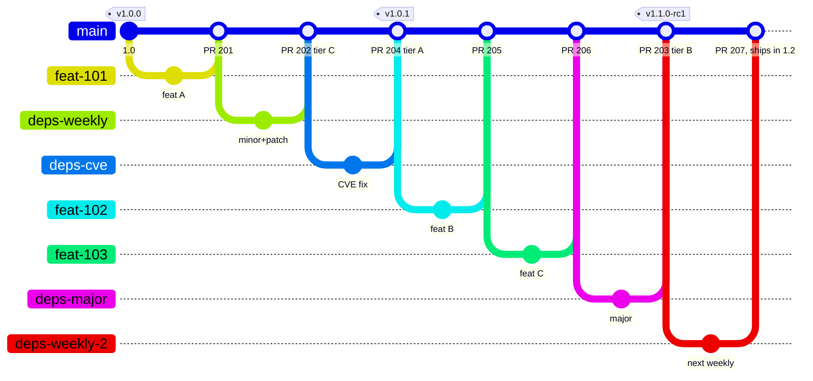
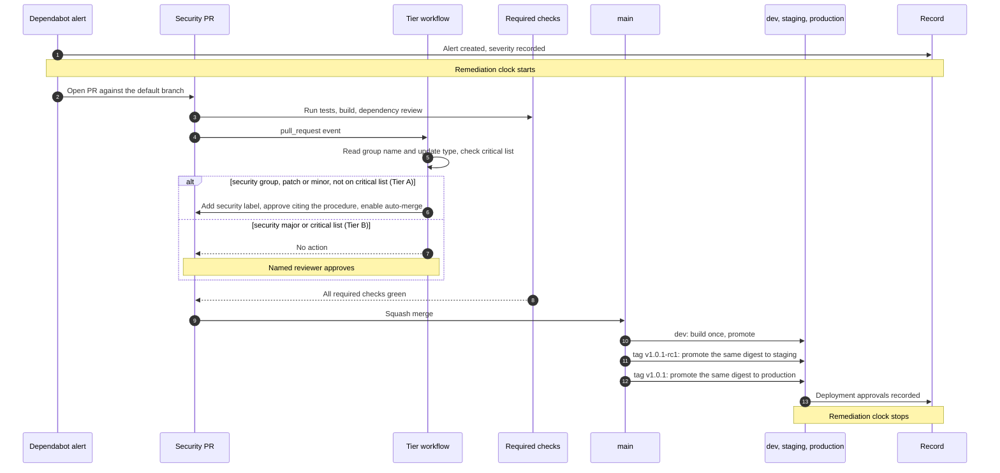
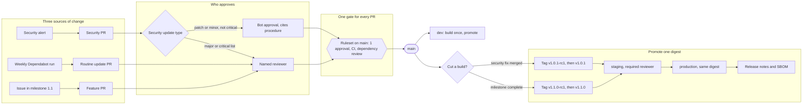

# Branch model

## The one rule

Every change to production is a pull request into `main` that passes the same gate. A release is a tag on `main`, not a branch. Environments receive artifacts, not branches.

## Why one branch

| Fact about the organisation | Consequence for the model |
|---|---|
| Production is SaaS on one version | No old release needs patching, so no long-lived release branches |
| Dependabot security updates always use the default branch | Any branch that is not the default never gets them. Environment branches would need every fix merged onward by hand |
| ISO 9001 says nothing about branches | It requires reviewed, authorised, verified, recorded changes. One gate on one branch is the simplest way to show that |
| CI is trusted | Verification can be automated for low-risk changes if the criteria are written once |

Environment branches (`dev`, `staging`, `prod`) were considered and rejected: a dependency bump becomes three pull requests, security fixes land on only one branch, and the promotion merges between branches become the real change with no review attached.

## Environments

| Environment | What it holds | What puts it there | How many builds at a time |
|---|---|---|---|
| `dev` | The head of `main` | Every merge, automatically | Always the latest |
| `staging` | One candidate build, release candidate or hotfix | A tag push, then a required reviewer | One |
| `production` | One released build | Approval of the digest staging just validated | One |

Only `dev` follows a branch. `staging` and `production` receive one specific digest, promoted by a person. With a single staging environment, a hotfix candidate replaces whatever release candidate was being checked; the candidate is an immutable artifact, so its checks resume rather than restart. If hotfixes become frequent, add a second staging environment.

## One cycle, drawn three ways

Version 1.0 is in production. Three issues make up release 1.1. Routine dependency updates and one security fix arrive while 1.1 is being built.

### Where commits and tags land

`main` is the top line. Each lower line is one pull request, from the commit it branched at to its merge. `v1.1.0` is a second tag on the same commit as `v1.1.0-rc1`. The weekly run that merges after the candidate is simply in the next release; that is correct, not a problem.

### The security fix, step by step

### The gate every pull request passes

