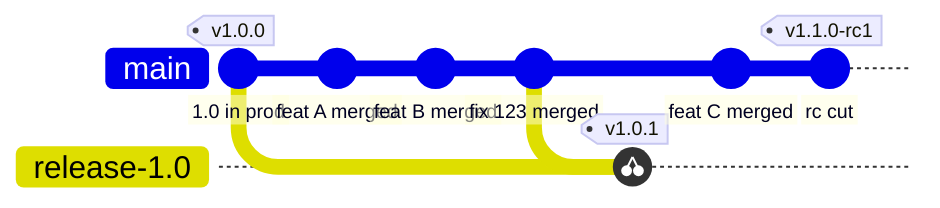

# Hotfix

Use this when a defect in production must be fixed before the next release and `main` holds work that is not ready to ship. If `main` is releasable, cut a release candidate from `main` instead; it is simpler.

## Steps

1. Open an issue from the bug template with severity. This is the nonconformity record.
2. Fix on `main` first, through a normal pull request. The fix is now permanent and will be in the next release. Fixing the release branch first and forgetting the forward-port is how a bug comes back.
3. Cut the release branch from the production tag. The ruleset covers `release/*`, so the gate applies.
4. Open a pull request into the release branch that cherry-picks the fix. CI runs against the old code. The reviewer confirms the cherry-pick matches the original.
5. Tag the merge commit as a release candidate so the staging gate is satisfied, validate, then tag the version. Production receives exactly the old release plus the fix.
6. Delete the release branch once the next version is in production. The tag keeps the commit.

```text
git switch -c release/1.0 v1.0.0
git push -u origin release/1.0

git switch -c backport/123-to-1.0 release/1.0
git cherry-pick -x <sha of the fix commit on main>
git push -u origin backport/123-to-1.0
# open PR: backport/123-to-1.0 -> release/1.0

# after that PR merges
git fetch origin
git tag -a v1.0.1-rc1 -m "Hotfix candidate for issue 123" origin/release/1.0
git push origin v1.0.1-rc1
# approve staging, validate
git tag -a v1.0.1 -m "Hotfix for issue 123" v1.0.1-rc1^{}
git push origin v1.0.1
# approve production
```

## In practice

- When the cherry-pick does not apply because the code has diverged, write the fix on the release branch first and forward-port it to `main` with a separate pull request. Either direction gives two linked pull requests.
- Dependabot never opens pull requests on the release branch. A security fix that must reach the old release travels by the same backport pull request.
- Squash merges keep this clean: the fix on `main` is one commit, so one cherry-pick carries it. The ruleset requires linear history for that reason.



The release branch starts at the commit production is running. The fix reaches `main` first, then the release branch by cherry-pick. Nothing merges back.

## Why this satisfies the quality system

ISO 9001 clause 8.5.6 asks that the change to production be reviewed, authorised, and recorded. With the release branch, the change to production is exactly the fix: anyone can diff the two tags and see one commit. Shipping a new build from `main` with unreleased features hidden behind flags also satisfies the clause, but the diff then contains code nobody validated for release, and you must argue that flags make it inert. The release branch does not need that argument.
